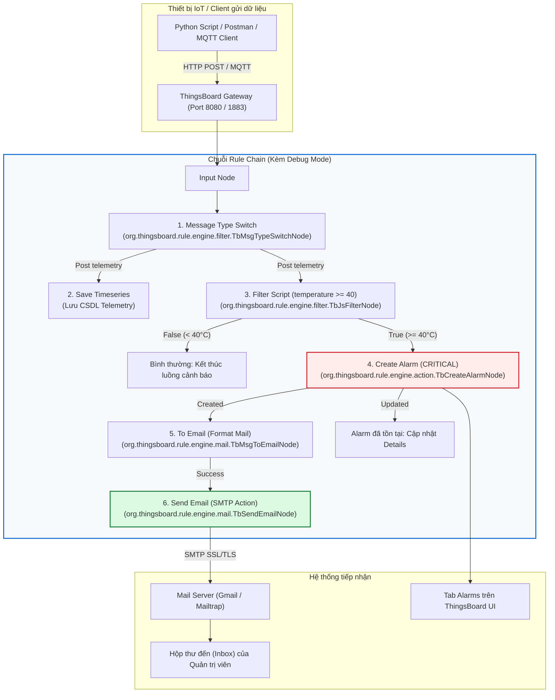

# Bài 5: Kiểm thử toàn diện chuỗi Rule Chain (End-to-End Testing)

## 1. Mục tiêu bài thực hành

- **Vận hành thử nghiệm toàn bộ hệ sinh thái IoT**: Từ thiết bị biên/mô phỏng gửi Telemetry qua HTTP/MQTT -> ThingsBoard Rule Engine xử lý qua bộ lọc -> Kích hoạt Cảnh báo (Alarm) -> Gửi Email thông báo khẩn cấp đến hộp thư người quản trị.
- **Khai thác chế độ Debug Mode**: Bật tính năng gỡ lỗi trực quan trên từng Rule Node để quan sát chính xác định dạng dữ liệu (Payload), siêu dữ liệu (Metadata) và mối quan hệ định tuyến (Relation Types: `Post telemetry`, `True`, `False`, `Created`, `Success`).
- **Xác thực kết quả thực tế**: Đối chiếu dữ liệu giữa bản ghi Debug của Rule Engine, bảng quản lý Alarms trên ThingsBoard và Hộp thư đến (Inbox) của người dùng.

---

## 2. Kiến trúc chuỗi Rule Chain & Luồng di chuyển của Message



---

## 3. Các tệp mã nguồn và cấu hình trong thư mục

Thư mục này bao gồm toàn bộ mã nguồn cần thiết để kiểm thử, **chạy ngay với Python Standard Library mà không cần cài thêm bất kỳ thư viện ngoài nào (Zero Dependencies)**:

| Tên tệp | Mô tả chi tiết | Thư viện yêu cầu |
|---|---|---|
| [`send_telemetry.py`](send_telemetry.py) | Script gửi dữ liệu HTTP REST API (Kịch bản tự động, gửi đơn lẻ, gửi đột biến) | Thư viện chuẩn (`urllib.request`, `json`, `time`) |
| [`send_telemetry_mqtt.py`](send_telemetry_mqtt.py) | Client MQTT thuần (Pure Socket MQTT 3.1.1) kết nối port 1883 | Thư viện chuẩn (`socket`, `struct`) - Không cần `paho-mqtt` |
| [`rule_chain_bai5_export.json`](rule_chain_bai5_export.json) | Bản cấu hình Rule Chain mẫu xuất từ ThingsBoard (đã bật sẵn Debug Mode) | Import trực tiếp vào ThingsBoard UI |
| [`postman_collection.json`](postman_collection.json) | Bộ sưu tập Postman v2.1 chứa các request test nhiệt độ bình thường và đột biến | Postman / Thunder Client |
| [`curl_test.bat`](curl_test.bat) | Script kiểm thử tự động 2 bước bằng cURL trên Windows | Windows CMD / PowerShell |
| [`curl_test.sh`](curl_test.sh) | Script kiểm thử tự động 2 bước bằng cURL trên Linux / macOS | Bash shell, cURL |

---

## 4. Hướng dẫn thiết lập trên ThingsBoard

### Bước 1: Tạo Thiết bị (Device) và lấy Access Token
1. Đăng nhập vào ThingsBoard Web UI (mặc định: `http://localhost:8080`).
2. Vào mục **Device Groups** -> **All** -> Nhấn nút **"+"** -> **Add new device**.
3. Đặt tên thiết bị: `Sensor_DHT22_Lab9`.
4. Sau khi tạo xong, mở chi tiết thiết bị, nhấn **Copy access token** (Ví dụ: `A1_TEST_TOKEN_LAB9`).

### Bước 2: Thiết lập Rule Chain
Có 2 cách thực hiện:

#### Cách 1: Import trực tiếp file cấu hình có sẵn (Khuyên dùng)
1. Vào mục **Rule Chains** trên menu trái.
2. Nhấn biểu tượng dấu **"+"** ở góc trên -> chọn **Import rule chain**.
3. Chọn file [`rule_chain_bai5_export.json`](rule_chain_bai5_export.json) trong thư mục này.
4. Đặt làm **Root Rule Chain** (hoặc liên kết từ Root Chain sang).

#### Cách 2: Tạo thủ công từng Node và cấu hình
1. **Message Type Switch Node**:
   - Tên: `Message Type Switch`
   - Bật toggle **Debug mode: ON**.
2. **Filter Script Node**:
   - Tên: `Check High Temperature (>= 40°C)`
   - Bật toggle **Debug mode: ON**.
   - Code JavaScript:
     ```javascript
     return typeof msg.temperature !== 'undefined' && msg.temperature >= 40;
     ```
   - Nối từ `Message Type Switch` sang node này với nhãn: `Post telemetry`.
3. **Create Alarm Node**:
   - Tên: `Create High Temp Alarm`
   - Bật toggle **Debug mode: ON**.
   - Alarm type: `High Temperature Alarm`
   - Alarm severity: `CRITICAL`
   - Details function:
     ```javascript
     var details = {};
     details.temperature = msg.temperature;
     details.threshold = 40.0;
     details.message = "CẢNH BÁO: Nhiệt độ vượt ngưỡng cho phép: " + msg.temperature + "°C!";
     return details;
     ```
   - Nối từ `Filter Script` sang node này với nhãn: `True`.
4. **To Email Node**:
   - Tên: `Format Alarm Email`
   - Bật toggle **Debug mode: ON**.
   - From template: `noreply@iot-lab.edu.vn` (hoặc email người gửi).
   - To template: `admin@gmail.com` (Email nhận cảnh báo của bạn).
   - Subject template: `[CẢNH BÁO KHẨN CẤP] Nhiệt độ vượt ngưỡng: ${temperature}°C - ${deviceName}`
   - Body template:
     ```html
     <h2>CẢNH BÁO QUÁ NHIỆT HỆ THỐNG</h2>
     <p>Thiết bị: <b>${deviceName}</b></p>
     <p>Nhiệt độ hiện tại: <b style="color:red;">${temperature}°C</b> (Ngưỡng an toàn: &lt; 40°C)</p>
     <p>Thời điểm: ${__msgTimestamp}</p>
     ```
   - Nối từ `Create Alarm` sang node này với nhãn: `Created`.
5. **Send Email Node**:
   - Tên: `Send Email via SMTP`
   - Bật toggle **Debug mode: ON**.
   - Nối từ `To Email` sang node này với nhãn: `Success`.

### Bước 3: Cấu hình Outgoing Mail Server (SMTP)
Để ThingsBoard gửi được email ra ngoài thực tế:
1. Đăng nhập với quyền **System Administrator** (`sysadmin@thingsboard.org`).
2. Vào mục **Settings** -> **Outgoing Mail**.
3. Điền thông số SMTP (Ví dụ dùng Gmail SMTP):
   - **Mail from**: `your-email@gmail.com`
   - **SMTP Protocol**: `SMTP`
   - **SMTP Host**: `smtp.gmail.com`
   - **SMTP Port**: `587`
   - **Timeout (ms)**: `10000`
   - **Enable TLS**: Tích chọn `TLS`
   - **Username**: `your-email@gmail.com`
   - **Password**: *Mật khẩu ứng dụng (App Password 16 ký tự của Google)*.
4. Nhấn **Send Test Email** để xác nhận kết nối SMTP thành công trước khi chạy lab.

---

## 5. Các bước thực hiện kiểm thử End-to-End

### Cách 1: Sử dụng Script Python (Chuẩn thư viện có sẵn)
Chạy kịch bản hoàn chỉnh (Gửi giá trị bình thường 25°C -> Đột ngột tăng lên 40.5°C):

```bash
# Thay TOKEN bằng Device Access Token của bạn
python send_telemetry.py --host localhost --port 8080 --token YOUR_DEVICE_ACCESS_TOKEN --mode scenario
```

Kết quả in ra màn hình:
```text
========================================================================
   THINGSBOARD RULE ENGINE - END-TO-END TELEMETRY TEST SCRIPT (HTTP)
   Bài 5: Kiểm thử toàn diện chuỗi Rule Chain với chế độ Debug Mode
   Thư viện: Python Standard Library (urllib.request) - Zero Dependencies
========================================================================

[*] Bắt đầu kịch bản kiểm thử End-to-End tới: http://localhost:8080
[*] Device Access Token: YOUR_DEVICE_ACCESS_TOKEN
[*] Khoảng nghỉ giữa các bản tin: 2.0s

--------------------------------------------------------------------------------
Bước   | Mô tả                               | Dữ liệu                   | Kết quả   
--------------------------------------------------------------------------------
#1     | Bình thường 1 (Baseline)            | {"temperature": 25.0}     | 200 OK (15.2ms) [OK] Bình thường
#2     | Bình thường 2 (Ổn định)             | {"temperature": 26.2}     | 200 OK (12.4ms) [OK] Bình thường
#3     | Bình thường 3 (Cận ngưỡng an toàn)  | {"temperature": 27.5}     | 200 OK (11.8ms) [OK] Bình thường
#4     | ĐỘT BIẾN NHIỆT ĐỘ VƯỢT NGƯỠNG (40°C)| {"temperature": 40.5}     | 200 OK (18.1ms) [!] KÍCH HOẠT ALARM
  >>>>> ĐÃ GỬI BẢN TIN NHIỆT ĐỘ >= 40°C!
  >>>>> Hãy kiểm tra ngay:
        1. Rule Engine Debug Tab (Filter Script: True, Create Alarm: Created)
        2. Tab 'Alarms' trên Thiết bị (Trạng thái: ACTIVE_UNACK)
        3. Hộp thư đến (Inbox) của Email người nhận
#5     | Nhiệt độ duy trì mức báo động       | {"temperature": 41.2}     | 200 OK (14.0ms) [!] KÍCH HOẠT ALARM
--------------------------------------------------------------------------------
[*] Hoàn thành kịch bản kiểm thử!
```

Hoặc gửi kiểm tra từng trường hợp riêng biệt:
```bash
# Chỉ gửi bản tin bình thường:
python send_telemetry.py --token YOUR_DEVICE_ACCESS_TOKEN --mode normal

# Chỉ gửi bản tin vượt ngưỡng cảnh báo:
python send_telemetry.py --token YOUR_DEVICE_ACCESS_TOKEN --mode alarm
```

---

### Cách 2: Sử dụng MQTT Client thuần (`send_telemetry_mqtt.py`)
```bash
python send_telemetry_mqtt.py --host localhost --port 1883 --token YOUR_DEVICE_ACCESS_TOKEN --mode scenario
```

---

### Cách 3: Sử dụng Postman
1. Mở Postman, chọn **Import** -> kéo thả file [`postman_collection.json`](postman_collection.json).
2. Chỉnh sửa biến `device_token` thành Token thiết bị của bạn.
3. Gửi request `1. Gửi Telemetry Nhiệt độ bình thường (26.5°C)` -> Nhận `200 OK`.
4. Gửi request `2. Gửi Telemetry Nhiệt độ ĐỘT BIẾN (40.5°C)` -> Nhận `200 OK`.

---

### Cách 4: Sử dụng cURL
- **Trên Windows**: Chạy tệp [`curl_test.bat`](curl_test.bat) hoặc dòng lệnh:
  ```cmd
  curl -X POST "http://localhost:8080/api/v1/YOUR_DEVICE_ACCESS_TOKEN/telemetry" -H "Content-Type: application/json" -d "{\"temperature\": 40.5}"
  ```
- **Trên Linux/macOS**:
  ```bash
  chmod +x curl_test.sh
  ./curl_test.sh
  ```

---

## 6. Phân tích bản ghi Debug trên Rule Engine

Sau khi gửi các bản tin trên, quay lại giao diện **Rule Chains** -> Mở Rule Chain và nhấp vào từng node để xem tab **Events / Debug**:

### 1. Tại Node "Filter Script (temperature >= 40)"
- **Khi gửi 26.5°C**:
  - `In Message`: `{"temperature": 26.5, "humidity": 60.0}`
  - `Out Message`: Giữ nguyên dữ liệu.
  - `Relation type`: **`False`**.
  - **Kết luận**: Nhánh rẽ sang `False`, luồng xử lý dừng lại, không kích hoạt cảnh báo.
- **Khi gửi 40.5°C**:
  - `In Message`: `{"temperature": 40.5, "humidity": 45.0}`
  - `Out Message`: Giữ nguyên dữ liệu.
  - `Relation type`: **`True`**.
  - **Kết luận**: Điều kiện kiểm tra khớp, message được đẩy tiếp tới node `Create Alarm`.

### 2. Tại Node "Create Alarm"
- `In Message`: Nhận dữ liệu nhiệt độ 40.5°C từ Filter Script.
- `Out Message`:
  ```json
  {
    "temperature": 40.5,
    "threshold": 40.0,
    "message": "CẢNH BÁO: Nhiệt độ vượt ngưỡng cho phép: 40.5°C!"
  }
  ```
- `Relation type`: **`Created`** (Nếu cảnh báo loại này chưa từng mở hoặc đã được Clear trước đó), hoặc **`Updated`** (Nếu cảnh báo đang ở trạng thái active).
- `Metadata`: Sinh các trường quản lý alarm như `alarmId`, `alarmSeverity: "CRITICAL"`, `alarmStatus: "ACTIVE_UNACK"`.

### 3. Tại Node "To Email"
- Biến đổi Message sang định dạng thư điện tử:
  - `from`: `noreply@iot-lab.edu.vn`
  - `to`: `admin@gmail.com`
  - `subject`: `[CẢNH BÁO KHẨN CẤP] Nhiệt độ vượt ngưỡng: 40.5°C - Sensor_DHT22_Lab9`
  - `body`: Nội dung HTML chứa bảng thông số chi tiết.
- `Relation type`: **`Success`**.

### 4. Tại Node "Send Email"
- Thực hiện kết nối socket SMTP TLS tới máy chủ mail.
- `Relation type`: **`Success`** kèm thời gian xử lý (latency ~ 300 - 800ms).
- Nếu cấu hình sai mật khẩu ứng dụng SMTP, node sẽ sinh sự kiện quan sát được với relation: **`Failure`** và ghi rõ mã lỗi `535 5.7.8 Username and Password not accepted`.

---

## 7. Kiểm tra kết quả thực tế

1. **Giao diện Alarms trên ThingsBoard**:
   - Truy cập **Entities** -> **Devices** -> Chọn thiết bị `Sensor_DHT22_Lab9` -> Chuyển sang tab **Alarms**.
   - Quan sát xuất hiện bản ghi cảnh báo:
     - **Alarm Type**: `High Temperature Alarm`
     - **Severity**: `CRITICAL`
     - **Status**: `Active Unacknowledged` (Chưa xác nhận)
     - **Details**: `{"temperature": 40.5, "threshold": 40.0, "message": "..."}`
2. **Hộp thư đến (Inbox) Email**:
   - Mở hòm thư quản trị viên đã cấu hình nhận mail.
   - Kiểm tra email mới nhận với tiêu đề `[CẢNH BÁO KHẨN CẤP] Nhiệt độ vượt ngưỡng: 40.5°C - Sensor_DHT22_Lab9`.
   - Nội dung hiển thị định dạng HTML chuẩn với bảng thông số và thời điểm cảnh báo rõ ràng.

---

## 8. Khắc phục sự cố thường gặp (Troubleshooting)

| Triệu chứng | Nguyên nhân có thể | Cách khắc phục |
|---|---|---|
| Gửi HTTP nhận lỗi `401 Unauthorized` | Sai Device Access Token | Kiểm tra lại Access Token trong mục Device Details trên ThingsBoard. |
| Node Filter không ra nhánh `True` dù nhiệt độ 40.5°C | Tên trường JSON không khớp (ví dụ `temp` thay vì `temperature`) | Kiểm tra lại JSON payload gửi đi phải đúng định dạng `{"temperature": 40.5}`. |
| Node Send Email báo `Failure` | Chưa bật App Password trên Google Mail hoặc sai cổng SMTP | Dùng Mật khẩu ứng dụng (Google App Password) 16 chữ số; Port 587 (TLS) hoặc 465 (SSL). |
| Tab Debug không hiển thị sự kiện | Chưa bật toggle Debug Mode trên Rule Node | Mở cấu hình node, gạt công tắc **Debug mode** sang **ON** và nhấn **Apply changes** rồi **Save Rule Chain**. |
