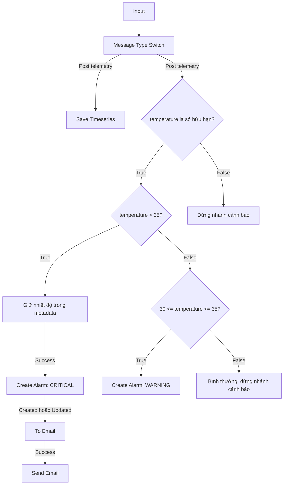

# Lab 9 – Bài tập về nhà – Bài 1: Phân tầng cảnh báo đa cấp

Theo đề trong `Lab 9.docx`, mở rộng Rule Chain ThingsBoard để phân loại nhiệt độ:

| Nhiệt độ T | Xử lý Alarm | Email |
|---|---|---|
| T < 30°C | Không tạo/cập nhật Alarm | Không gửi |
| 30°C ≤ T ≤ 35°C | Tạo/cập nhật Alarm mức `WARNING` | Không gửi |
| T > 35°C | Tạo/cập nhật Alarm mức `CRITICAL` | Gửi email khẩn cấp |
| Thiếu `temperature` hoặc giá trị không phải số hữu hạn | Dừng nhánh cảnh báo | Không gửi |

**30°C và 35°C đều thuộc Warning.** Telemetry vẫn được đưa vào Save Timeseries, kể cả bản tin thiếu hoặc sai kiểu nhiệt độ; nhánh cảnh báo chỉ nhận số JSON hợp lệ.

## Tệp trong bài

| Tệp | Công dụng |
|---|---|
| [rule_chain_bai1_export.json](rule_chain_bai1_export.json) | Cấu hình Rule Chain để import vào ThingsBoard |
| [send_telemetry.py](send_telemetry.py) | Gửi HTTP telemetry bằng thư viện chuẩn Python; hỗ trợ dry run |
| [postman_collection_bai1.json](postman_collection_bai1.json) | Tám request kiểm tra các ngưỡng và dữ liệu sai kiểu |
| [test_rule_chain.cjs](test_rule_chain.cjs) | Kiểm tra offline JS, kết nối nhánh và template email; cần Node.js |

## Luồng xử lý



Hai node Create Alarm dùng chung **Alarm type `HighTemperatureAlert`**. Vì vậy, một thiết bị có Alarm đang mở sẽ được cập nhật mức độ thay vì tạo hai Alarm riêng. Trong bài này mức độ phản ánh mẫu nhiệt độ mới nhất thuộc vùng cảnh báo.

Ở nhánh Critical, nối **cả `Created` lẫn `Updated`** đến To Email. Như vậy, khi nhiệt độ tăng từ 32°C lên 40°C, Alarm Warning có sẵn được cập nhật thành Critical và vẫn gửi email. Cấu hình này gửi email với **mỗi bản tin Critical**, kể cả Critical lặp lại; đề bài chưa yêu cầu giới hạn tần suất.

Sau Create Alarm, payload có thể trở thành đối tượng Alarm. Node `Keep temperature for email` lưu `alertTemperature` và `alertDevice` trong metadata trước đó, để template `${alertTemperature}` và `${alertDevice}` luôn lấy đúng thông tin.

## Thiết lập trên ThingsBoard

### 1. Chuẩn bị thiết bị

1. Đăng nhập tài khoản quản trị tenant trên ThingsBoard của bạn.
2. Trong **Entities → Devices** (hoặc **Devices**, tùy phiên bản), tạo thiết bị `Sensor_Lab9_Bai1`.
3. Mở thiết bị và chọn **Copy access token**. Token này dùng để gửi telemetry, không phải mật khẩu đăng nhập ThingsBoard.

### 2. Import và nối từ Root Rule Chain

1. Vào **Rule Chains → + → Import rule chain**, chọn `rule_chain_bai1_export.json`.
2. Mở chain `Smart_Environment_Alert_BTVN_Bai1` vừa import và lưu lại.
3. Mở **Root Rule Chain** đang xử lý thiết bị. Thêm node **Rule chain**, chọn chain vừa import.
4. Nối từ node **Message Type Switch** của Root đến node Rule chain mới bằng quan hệ **`Post telemetry`**, rồi lưu.
5. Các node trong file bật `debugMode`. Kiểm tra Debug trên giao diện và bật lại nếu phiên bản ThingsBoard của bạn không giữ cờ này sau import.

Chain bài này có Save Timeseries riêng. Nếu Root đã lưu telemetry, chỉ giữ một đường lưu cho các bản tin của thiết bị lab để tránh ghi lặp. Khi thử bài, cho telemetry của thiết bị đi vào chain này một lần và gỡ đường dẫn đến các chain lab cũ có tạo Alarm/email, nếu có.

Nếu không import được do khác phiên bản, tạo thủ công các node theo sơ đồ; sao chép phần `configuration` của từng node từ JSON. Với Script node, chọn ngôn ngữ **JavaScript (JS)**.

### 3. Cấu hình email

1. Mở node **To Email - Critical only**. Thay `sender@example.com` bằng địa chỉ gửi được SMTP cho phép và `recipient@example.com` bằng hộp thư nhận của bạn.
2. Node **Send Email via system SMTP** bật `useSystemSmtpSettings`. Tài khoản có quyền quản trị hệ thống cần cấu hình máy chủ thư tại **Settings → Outgoing Mail / Mail server**, tùy phiên bản. Điền host, port, TLS, tài khoản và mật khẩu theo dịch vụ SMTP đang dùng, rồi gửi thư thử.
3. Nếu không có quyền dùng SMTP hệ thống, mở Send Email, bỏ chọn dùng cấu hình hệ thống và nhập SMTP riêng trên giao diện. Không lưu mật khẩu SMTP vào bài nộp.
4. Lưu Rule Chain. Chỉ nhánh Critical có đường nối đến To Email và Send Email.

## Chạy kiểm thử

Mở terminal tại thư mục bài:

```powershell
cd lab9/btvn/bai1
python send_telemetry.py --dry-run
node test_rule_chain.cjs
```

Dry run chỉ hiển thị kịch bản, không gửi dữ liệu. File kiểm thử Node thực thi các đoạn JS trong JSON và mô phỏng action; chưa xác nhận import, SMTP hoặc server ThingsBoard.

Gửi toàn bộ kịch bản đến ThingsBoard (thay URL và token của bạn):

```powershell
python send_telemetry.py --url http://localhost:8080 --token YOUR_DEVICE_ACCESS_TOKEN
```

Có thể đặt token qua biến môi trường `TB_DEVICE_TOKEN`, rồi bỏ tùy chọn `--token`. Script không in token ra terminal. Hỗ trợ cả URL HTTPS, ví dụ `--url https://demo.thingsboard.io` nếu đó là máy chủ tài khoản của bạn.

Gửi riêng từng mức để dễ quan sát, đợi Rule Engine xử lý xong và chụp kết quả sau mỗi lệnh:

```powershell
python send_telemetry.py --token YOUR_DEVICE_ACCESS_TOKEN --temperature 32
python send_telemetry.py --token YOUR_DEVICE_ACCESS_TOKEN --temperature 40
```

Hoặc import Postman collection, đặt `base_url` và `device_token`, chạy từng request theo thứ tự. HTTP 2xx chỉ xác nhận endpoint nhận telemetry; cần kiểm tra Alarms, Debug và hộp thư để kết luận kết quả.

### Kết quả cần đối chiếu

Nên bắt đầu với thiết bị lab mới hoặc clear Alarm cũ bằng giao diện trước khi chạy. Chờ xử lý sau từng request; khoảng nghỉ mặc định của script là 2 giây, có thể tăng bằng `--delay 5`.

| Bước | Payload | Kết quả mong đợi |
|---|---|---|
| 1 | `{"temperature":29.9}` | Lưu telemetry; chưa tạo Alarm, không email |
| 2 | `{"temperature":30}` | Tạo `HighTemperatureAlert`, severity `WARNING`, không email |
| 3 | `{"temperature":32}` | Cập nhật Warning, không email |
| 4 | `{"temperature":35}` | Vẫn Warning, không email |
| 5 | `{"temperature":35.1}` | Cập nhật cùng Alarm thành `CRITICAL`; qua `Updated` đến To Email và Send Email |
| 6 | `{"temperature":40}` | Vẫn Critical; gửi thêm email chứa 40°C và tên thiết bị |
| 7 | `{"humidity":60}` | Node Valid temperature trả `False`; không xử lý Alarm/email |
| 8 | `{"temperature":"40"}` | Node Valid temperature trả `False`; chuỗi không được xem là số |

Để kiểm tra cả quan hệ `Created` của Critical, clear Alarm hiện có bằng giao diện rồi gửi riêng 40°C. Alarm Critical mới phải được tạo và email phải được gửi.

**Bài 1 chưa tự động clear Alarm khi T < 30°C**: chỉ dừng nhánh cảnh báo và giữ Alarm đang mở. Logic phục hồi/clear là yêu cầu riêng của Bài 3.

## Ghi nhận để nộp bài

Chụp sơ đồ Rule Chain, Alarm Warning khi gửi 32°C, Alarm Critical khi gửi 40°C, Debug của hai nhánh và email khẩn cấp đã nhận. Ghi nhận Warning không chạy node gửi mail trong Debug; không dùng riêng việc chưa thấy mail trong Inbox để kết luận.

Giải thích có thể dùng khi báo cáo: “Hệ thống lọc dữ liệu nhiệt độ hợp lệ, sau đó kiểm tra ngưỡng trên 35°C trước. Nếu đúng, tạo/cập nhật Alarm Critical và gửi email khẩn cấp. Nếu sai, kiểm tra đoạn 30–35°C để tạo/cập nhật Alarm Warning, không gửi email. Các giá trị dưới 30°C chỉ được lưu telemetry. Hai nhánh dùng cùng loại Alarm để cập nhật mức độ khi nhiệt độ thay đổi.”

Nếu HTTP báo thành công nhưng chưa có kết quả, kiểm tra đường nối từ Root, Device Profile có dùng Root đó không, đúng nhãn `Post telemetry`/`True`/`Created`/`Updated`/`Success`, và Debug Events của từng node. Nếu Alarm đã xuất hiện mà email chưa đến, kiểm tra To Email, Send Email, cấu hình SMTP và thư mục Spam.

Tài liệu đối chiếu: [Create Alarm](https://thingsboard.io/docs/reference/rule-engine/nodes/action/create-alarm/), [To Email](https://thingsboard.io/docs/reference/rule-engine/nodes/transformation/to-email/), [Send Email](https://thingsboard.io/docs/reference/rule-engine/nodes/external/send-email/).
