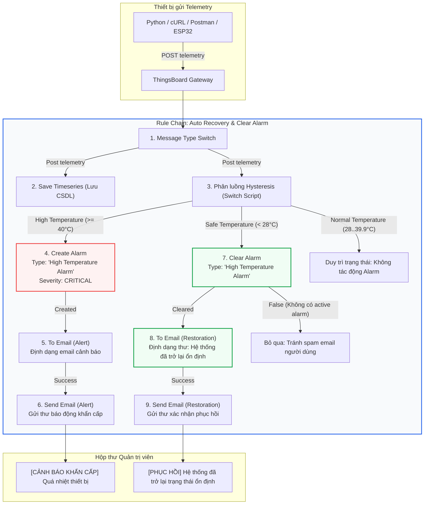

# Bài 3 (BTVN): Xây dựng Logic Tự động Phục hồi và Xóa Cảnh báo (Clear Alarm)

## 1. Mục tiêu và Đặt vấn đề

Trong các hệ thống giám sát IoT công nghiệp thực tế, một trong những sai lầm phổ biến nhất khi xây dựng Rule Engine là **"Treo cảnh báo" (Alarm Hanging)**:
- Khi nhiệt độ vượt ngưỡng (ví dụ $\ge 40^\circ\text{C}$), hệ thống kích hoạt cảnh báo `ACTIVE_UNACK` và gửi email cho người phụ trách.
- Tuy nhiên, sau khi kỹ thuật viên xử lý (bật điều hòa, sửa quạt làm mát) hoặc môi trường tự hạ nhiệt xuống mức an toàn, hệ thống **không tự động giải phóng cảnh báo**, khiến cờ báo động bị treo vĩnh viễn trên Dashboard quản lý.
- Hậu quả: Người vận hành tưởng rằng sự cố vẫn đang tiếp diễn, hoặc hình thành tâm lý chủ quan bỏ qua các cảnh báo thực tế tiếp theo.

### Yêu cầu giải quyết trong bài:
1. **Bổ sung luồng xử lý trạng thái bình thường hóa**: Khi nhiệt độ giảm xuống dưới mức an toàn ($< 28^\circ\text{C}$), Rule Chain tự động kích hoạt node `Clear Alarm`.
2. **Gửi thông báo phụ bản xác nhận**: Gửi một email xác nhận với nội dung `"Hệ thống đã trở lại trạng thái ổn định"` nhằm thông báo kịp thời cho người quản trị và tự động chuyển trạng thái Alarm sang `CLEARED`.
3. **Cơ chế chống chập chờn (Anti-flapping / Hysteresis)**: Áp dụng dải trễ giữa ngưỡng kích hoạt ($\ge 40^\circ\text{C}$) và ngưỡng phục hồi ($< 28^\circ\text{C}$) để tránh việc bật/tắt cảnh báo liên tục khi nhiệt độ dao động quanh một mốc cố định.

---

## 2. Nguyên lý Hysteresis & Vòng đời Cảnh báo (Alarm Lifecycle)

### 2.1. Vùng trễ Hysteresis
Để chống nhiễu và hiện tượng đảo trạng thái liên tục:
- **Vùng kích hoạt báo động**: $\text{Nhiệt độ} \ge 40^\circ\text{C} \rightarrow$ Tạo cảnh báo mới (Create Alarm) và gửi email khẩn cấp.
- **Vùng duy trì trạng thái (Dead-band / Hysteresis)**: $28^\circ\text{C} \le \text{Nhiệt độ} < 40^\circ\text{C} \rightarrow$ Giữ nguyên trạng thái hiện tại (nếu đang Alarm thì vẫn tiếp tục Alarm; nếu đang bình thường thì không sinh sự kiện).
- **Vùng an toàn phục hồi**: $\text{Nhiệt độ} < 28^\circ\text{C} \rightarrow$ Kích hoạt xóa cảnh báo (Clear Alarm) và gửi email xác nhận an toàn.

### 2.2. Vòng đời của một Alarm trên ThingsBoard
```
                     +---------------------------------------+
                     |         TRẠNG THÁI BÌNH THƯỜNG        |
                     +---------------------------------------+
                                         |
                                (T >= 40°C: Create Alarm)
                                         v
                     +---------------------------------------+
                     |         ACTIVE_UNACKNOWLEDGED         |  <--- Gửi Email Báo Động
                     |       (Đang báo động, chưa xác nhận)  |
                     +---------------------------------------+
                               |                   |
           (T < 28°C: Clear Alarm)       (User click Acknowledge)
                               v                   v
+---------------------------------------+     +---------------------------------------+
|        CLEARED_UNACKNOWLEDGED         |     |          ACTIVE_ACKNOWLEDGED          |
|    (Đã hết sự cố, chưa xác nhận)      |     |       (Đã xác nhận, vẫn đang nóng)    |
+---------------------------------------+     +---------------------------------------+
              | (Gửi Email Phục hồi)                       | (T < 28°C: Clear Alarm)
              |                                            |
              +--------------------+-----------------------+
                                   |
                                   v
                     +---------------------------------------+
                     |         CLEARED_ACKNOWLEDGED          |
                     |         (Đã xử lý & Đã xác nhận)      |
                     +---------------------------------------+
```

---

## 3. Kiến trúc Rule Chain nâng cao với Luồng Tự động Phục hồi



> [!IMPORTANT]
> **Điểm mấu chốt trong thiết kế Rule Chain:**
> Node `Clear Alarm` được nối sang `To Email (Restoration)` bằng quan hệ **`Cleared`** (chứ không dùng `Success`). 
> Quan hệ `Cleared` **chỉ được kích hoạt khi trước đó thực sự có một Alarm đang Active được xóa**. Khi thiết bị gửi nhiệt độ bình thường liên tục ($25^\circ\text{C}$), node `Clear Alarm` trả về nhánh `False`, hoàn toàn **không gửi email rác (spam)** làm phiền người dùng!

---

## 4. Các tệp mã nguồn và cấu hình trong thư mục

Toàn bộ script được viết bằng **Python Standard Library (100% không cần cài thư viện bên thứ ba)**:

| Tên tệp | Chức năng | Thư viện |
|---|---|---|
| [`simulate_recovery.py`](simulate_recovery.py) | Mô phỏng trọn vẹn 5 pha vòng đời (Ổn định -> Quá nhiệt -> Vùng đệm -> Phục hồi -> Duy trì) | Thư viện chuẩn (`urllib.request`, `json`, `time`) |
| [`rule_chain_bai3_clear_alarm_export.json`](rule_chain_bai3_clear_alarm_export.json) | Bản cấu hình Rule Chain hoàn chỉnh hỗ trợ Create & Clear Alarm | Import trực tiếp vào ThingsBoard |
| [`postman_collection_recovery.json`](postman_collection_recovery.json) | Bộ test 4 request Postman tương ứng các pha nhiệt độ | Postman v2.1 |
| [`curl_test_recovery.bat`](curl_test_recovery.bat) | Script chạy kiểm thử tự động trên Windows | Windows Batch |
| [`curl_test_recovery.sh`](curl_test_recovery.sh) | Script chạy kiểm thử tự động trên Linux/macOS | Bash Script |

---

## 5. Hướng dẫn cấu hình chi tiết trên ThingsBoard

### Cách 1: Import file có sẵn (Nhanh nhất)
1. Trên ThingsBoard Web UI, vào **Rule Chains** -> bấm biểu tượng **"+"** -> **Import rule chain**.
2. Chọn tệp [`rule_chain_bai3_clear_alarm_export.json`](rule_chain_bai3_clear_alarm_export.json).
3. Bật làm **Root Rule Chain** (hoặc liên kết từ Root Chain hiện có).

---

### Cách 2: Tự thiết lập cấu hình từng Node thủ công

#### Node 1: Phân loại bản tin (`Message Type Switch`)
- Type: `org.thingsboard.rule.engine.filter.TbMsgTypeSwitchNode`
- Bật **Debug mode: ON**.

#### Node 2: Phân luồng Hysteresis (`Switch Script Node`)
- Type: `org.thingsboard.rule.engine.filter.TbJsSwitchNode`
- Tên: `Check Temperature Levels (Switch)`
- Bật **Debug mode: ON**.
- Mã nguồn JavaScript:
  ```javascript
  if (typeof msg.temperature !== 'undefined') {
      if (msg.temperature >= 40) {
          return ['High Temperature'];
      } else if (msg.temperature < 28) {
          return ['Safe Temperature'];
      }
  }
  return ['Normal Temperature'];
  ```
- Nối từ Node 1 sang Node 2 với quan hệ: `Post telemetry`.

#### Node 3: Tạo cảnh báo (`Create Alarm Node`)
- Type: `org.thingsboard.rule.engine.action.TbCreateAlarmNode`
- Alarm Type: `High Temperature Alarm`
- Severity: `CRITICAL`
- Alarm Details Builder:
  ```javascript
  var details = {};
  details.temperature = msg.temperature;
  details.threshold = 40.0;
  details.status = 'ACTIVE';
  details.message = 'CẢNH BÁO: Nhiệt độ vượt ngưỡng an toàn: ' + msg.temperature + '°C (>= 40°C)!';
  return details;
  ```
- Nối từ Node 2 sang Node 3 với quan hệ: `High Temperature`.

#### Node 4 & 5: Gửi Email Cảnh báo Sự cố
- Node 4 (`To Email`):
  - Subject template: `[CẢNH BÁO KHẨN CẤP] Quá nhiệt thiết bị ${deviceName}: ${temperature}°C`
  - Body template: Bảng thông báo màu đỏ cảnh báo sự cố quá nhiệt.
  - Nối từ Node 3 sang Node 4 với quan hệ: `Created`.
- Node 5 (`Send Email`): Sử dụng SMTP gửi thư.
  - Nối từ Node 4 sang Node 5 với quan hệ: `Success`.

#### Node 6: Tự động Xóa Cảnh báo (`Clear Alarm Node`)
- Type: `org.thingsboard.rule.engine.action.TbClearAlarmNode`
- Alarm Type: `High Temperature Alarm` *(Lưu ý: Phải trùng khớp 100% với tên Alarm Type ở Node 3!)*
- Alarm Details Builder:
  ```javascript
  var details = {};
  details.temperature = msg.temperature;
  details.safeThreshold = 28.0;
  details.status = 'CLEARED';
  details.message = 'Hệ thống đã trở lại trạng thái ổn định (Nhiệt độ hiện tại: ' + msg.temperature + '°C < 28°C)';
  details.clearedAt = new Date().toISOString();
  return details;
  ```
- Nối từ Node 2 sang Node 6 với quan hệ: `Safe Temperature`.

#### Node 7 & 8: Gửi Email Xác nhận Khôi phục Hệ thống
- Node 7 (`To Email`):
  - Tên: `Format Restoration Email`
  - Subject template: `[PHỤC HỒI] Hệ thống đã trở lại trạng thái ổn định - ${deviceName}`
  - Body template:
    ```html
    <div style="font-family: Arial, sans-serif; padding: 20px; border: 2px solid #52c41a; border-radius: 8px;">
      <h2 style="color: #237804;">✅ THÔNG BÁO KHÔI PHỤC TRẠNG THÁI HỆ THỐNG</h2>
      <p>Cảnh báo quá nhiệt <b>High Temperature Alarm</b> đã được hệ thống <b>TỰ ĐỘNG XÓA (CLEARED)</b> thành công.</p>
      <ul>
        <li>Thiết bị: <b>${deviceName}</b></li>
        <li>Nhiệt độ hiện tại: <b style="color:green;">${temperature} °C</b> (&lt; 28.0 °C)</li>
        <li>Trạng thái cảnh báo: <b>CLEARED (ĐÃ PHỤC HỒI)</b></li>
        <li>Thời điểm phục hồi: <b>${__msgTimestamp}</b></li>
      </ul>
      <p><i>Hệ thống xác nhận trạng thái vận hành đã ổn định an toàn!</i></p>
    </div>
    ```
  - **Liên kết quan trọng**: Nối từ Node 6 (`Clear Alarm`) sang Node 7 với quan hệ: **`Cleared`**.
- Node 8 (`Send Email`): Gửi thư phục hồi qua SMTP.
  - Nối từ Node 7 sang Node 8 với quan hệ: `Success`.

---

## 6. Hướng dẫn chạy kiểm thử mô phỏng chu trình phục hồi

### 6.1. Sử dụng script tự động (`simulate_recovery.py`)
Mở Terminal và thực thi lệnh:
```bash
python simulate_recovery.py --host localhost --port 8080 --token YOUR_DEVICE_ACCESS_TOKEN --delay 3.0
```

### 6.2. Tiến trình diễn biến và kết quả quan sát
Script sẽ lần lượt kích hoạt 5 pha mô phỏng:

```text
========================================================================================
Pha                | Nhiệt độ   | Trạng thái kỳ vọng     | Hành vi Rule Engine           
========================================================================================
Pha 1: Ổn định     |  25.5 °C   | BÌNH THƯỜNG            | Lưu timeseries, không kích hoạt alarm
   -> Dữ liệu gửi: {"temperature": 25.5, "humidity": 60.0} | HTTP Phản hồi: 200 OK (15.1ms)
   -> Mô tả: Nhiệt độ phòng ban đầu bình thường

Pha 2: Quá nhiệt   |  41.5 °C   | BÁO ĐỘNG (ALARM ACTIVE)| [!] CREATE ALARM + GỬI EMAIL CẢNH BÁO SỰ CỐ
   -> Dữ liệu gửi: {"temperature": 41.5, "humidity": 42.0} | HTTP Phản hồi: 200 OK (18.4ms)
   -> Mô tả: Nhiệt độ bùng phát vượt ngưỡng cảnh báo (>= 40°C)
   ------------------------------------------------------------------------
   >>> [BƯỚC 2: KIỂM TRA BÁO ĐỘNG]
       - Tab Alarms: Alarm 'High Temperature Alarm' chuyển sang ACTIVE_UNACK
       - Email: Nhận thư cảnh báo quá nhiệt [CẢNH BÁO KHẨN CẤP]
   ------------------------------------------------------------------------

Pha 3: Giảm nhiệt  |  32.0 °C   | VẪN GIỮ ALARM ACTIVE   | Chưa an toàn (< 28°C), không xóa alarm tránh chập chờn (anti-flapping)
   -> Dữ liệu gửi: {"temperature": 32.0, "humidity": 50.0} | HTTP Phản hồi: 200 OK (12.2ms)
   -> Mô tả: Bật máy lạnh, nhiệt độ hạ về 32°C (Vùng đệm Hysteresis)

Pha 4: Phục hồi    |  26.5 °C   | TỰ ĐỘNG XÓA (CLEARED)  | [+] KÍCH HOẠT CLEAR ALARM + GỬI EMAIL XÁC NHẬN ỔN ĐỊNH
   -> Dữ liệu gửi: {"temperature": 26.5, "humidity": 58.0} | HTTP Phản hồi: 200 OK (19.0ms)
   -> Mô tả: Nhiệt độ giảm sâu về 26.5°C (Dưới ngưỡng an toàn < 28°C)
   ------------------------------------------------------------------------
   >>> [BƯỚC 4: KIỂM TRA PHỤC HỒI]
       - Tab Alarms: Alarm chuyển sang trạng thái CLEARED_UNACK (Đã xóa)
       - Email: Nhận thư phụ bản xác nhận [PHỤC HỒI] Hệ thống trở lại ổn định
   ------------------------------------------------------------------------

Pha 5: Duy trì     |  25.0 °C   | CLEARED / ỔN ĐỊNH      | Clear Alarm trả về False (không còn active alarm) -> KHÔNG SPAM EMAIL
   -> Dữ liệu gửi: {"temperature": 25.0, "humidity": 61.0} | HTTP Phản hồi: 200 OK (11.5ms)
   -> Mô tả: Nhiệt độ tiếp tục giữ mức ổn định 25.0°C
========================================================================================
[*] Kết thúc kịch bản kiểm thử tự động phục hồi và xóa cảnh báo thành công!
```

---

## 7. Bảng đối chiếu kết quả kiểm thử trên ThingsBoard

| Pha kiểm thử | Nhiệt độ gửi | Nhánh rẽ Switch Script | Hành vi Node Alarm | Trạng thái hiển thị trên Tab Alarms | Trạng thái Hộp thư Email |
|---|---|---|---|---|---|
| **Pha 1: Ổn định** | $25.5^\circ\text{C}$ | `Safe Temperature` | Clear Alarm $\rightarrow$ `False` | Không có Alarm nào hiển thị | Không có email |
| **Pha 2: Quá nhiệt** | $41.5^\circ\text{C}$ | `High Temperature` | Create Alarm $\rightarrow$ `Created` | **ACTIVE_UNACK** (Màu đỏ) | **Nhận email báo động khẩn cấp** |
| **Pha 3: Vùng đệm** | $32.0^\circ\text{C}$ | `Normal Temperature` | Không đi vào Alarm Node | **ACTIVE_UNACK** (Giữ nguyên) | Không gửi email |
| **Pha 4: Phục hồi** | $26.5^\circ\text{C}$ | `Safe Temperature` | Clear Alarm $\rightarrow$ `Cleared` | **CLEARED_UNACK** (Màu xanh/xám nhạt) | **Nhận email xác nhận: "Hệ thống đã trở lại trạng thái ổn định"** |
| **Pha 5: Duy trì** | $25.0^\circ\text{C}$ | `Safe Temperature` | Clear Alarm $\rightarrow$ `False` | **CLEARED_UNACK** (Giữ nguyên) | **Không gửi thêm email (Chống spam)** |

---

## 8. Kiểm tra bản ghi Debug trên Rule Engine

1. **Khi ở Pha 4 (Nhiệt độ $26.5^\circ\text{C}$)**:
   - Mở node `Clear Alarm`, chuyển sang tab **Events**.
   - Quan sát event:
     - `In`: `{"temperature": 26.5, ...}`
     - `Out`:
       ```json
       {
         "temperature": 26.5,
         "safeThreshold": 28.0,
         "status": "CLEARED",
         "message": "Hệ thống đã trở lại trạng thái ổn định (Nhiệt độ hiện tại: 26.5°C < 28°C)"
       }
       ```
     - `Relation type`: **`Cleared`**.
   - Mở tiếp node `To Email (Restoration)`:
     - Ghi nhận `In message` từ sự kiện `Cleared` trên và đóng gói thành email phục hồi `Success`.
2. **Khi ở Pha 5 (Nhiệt độ $25.0^\circ\text{C}$ tiếp tục gửi)**:
   - Mở node `Clear Alarm`:
   - Quan sát event sinh ra với `Relation type`: **`False`**.
   - Do không có quan hệ `Cleared`, message dừng lại và không kích hoạt node gửi email -> Đạt chuẩn bảo vệ hộp thư tránh thư rác.
